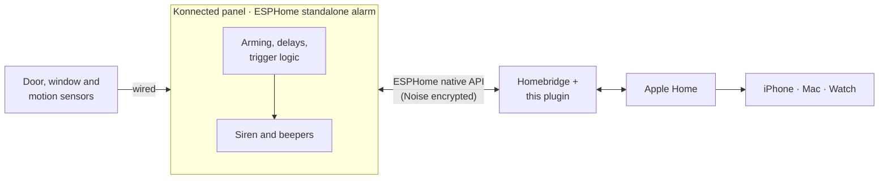

<div align="center">

# Konnected Standalone for Homebridge

**Apple Home for Konnected alarm panels running ESPHome standalone alarm mode.**
A native Home alarm tile and live zone sensors. The siren keeps working even when Homebridge doesn't.

[](https://github.com/peterrakolcza/homebridge-konnected-standalone/actions/workflows/build.yml)


<sub>Unofficial. Not affiliated with, endorsed by, or supported by Konnected Inc. or the Homebridge project.</sub>

</div>

---

## Why this plugin

Konnected's ESPHome firmware can run a **complete alarm system on the panel itself**: arming, entry and exit delays, bypass and the siren. Konnected supports it through Home Assistant only. This plugin brings it to Apple Home through Homebridge, without moving the alarm logic off the panel.



| If this goes down… | What still works |
|---|---|
| Homebridge or its server | **The alarm and siren**, on the panel. You lose Home control and notifications until it's back. |
| Internet | The alarm, siren and Home control on your LAN. No remote notifications. |
| Panel Wi-Fi | The alarm and siren, on the panel. Home shows the tile as faulted. |

## What you get in Apple Home

- 🛡️ **One Security System tile per panel**: Home, Away, Night and Off. It shows "Arming…" during the exit delay and **Triggered** with the standard Home alarm notification.
- 🚪 **One live sensor per zone**: motion by default, or a contact sensor per zone.
- ✅ **Honest state**: Home only shows what the panel reports. A request the panel doesn't confirm reverts. An offline panel shows "No Response" straight away, never a fake "Arming…".
- 🔐 **Secure by default**: Noise encryption is required whenever a key is set. The plugin refuses plaintext fallbacks and malformed keys, and never logs your code or key.
- 🔎 **Optional discovery**: finds configured panels by MAC on the network and follows them if their IP changes.

## Quick start

1. **Flash the panel** with Konnected's ESPHome firmware and enable the standalone alarm. See [Konnected: Standalone Alarm System](https://support.konnected.io/standalone-alarm-system-on-the-konnected-alarm-panel).
2. **Set an API encryption key** in the panel's ESPHome config:
   ```yaml
   api:
     encryption:
       key: "<32-byte base64 key>"   # generate one at https://esphome.io/components/api/
   ```
3. **Install the plugin** from the Homebridge UI (search for *Konnected Standalone*), or run:
   ```bash
   npm install -g homebridge-konnected-standalone
   ```
4. **Add your panel** in the plugin settings: its IP (or MAC), the encryption key and, if your panel uses one, the alarm code.
5. **Restart Homebridge.** The alarm tile and zone sensors appear in Apple Home.

## Configuration

### Plugin settings in the Homebridge UI

<table>
  <tr>
    <td width="50%" valign="top">
      <b>Panel</b><br/>
      Address, encryption key and optional alarm code. The key and code are masked.<br/><br/>
      
    </td>
    <td width="50%" valign="top">
      <b>Zone overrides</b><br/>
      Optional. Show a zone as a contact sensor, or hide it.<br/><br/>
      
      <br/><br/>
      <b>Advanced</b><br/>
      Command timeout and network discovery.<br/><br/>
      
    </td>
  </tr>
</table>

<details>
<summary>Full settings dialog</summary>


</details>

### `config.json`

```jsonc
{
  "platform": "KonnectedStandalone",
  "name": "Konnected Standalone",
  "panels": [
    {
      "name": "House alarm",
      "host": "192.168.1.44",
      "encryptionKey": "base64…",
      "code": "1234",
      "zones": [
        { "id": "Entry", "type": "contact" },
        { "id": "zone_6", "hidden": true }
      ]
    }
  ]
}
```

| Option | Default | Description |
|---|---|---|
| `panels[].name` | alarm entity name | Name of the Security System tile. |
| `panels[].host` | — | Panel IP or hostname. Either `host` or `mac` is required. |
| `panels[].mac` | — | Panel MAC. Without `host`, the panel is found by mDNS and followed if its IP changes. |
| `panels[].port` | `6053` | ESPHome native API port. |
| `panels[].encryptionKey` | — | The panel's `api: encryption: key`. Must be a 32-byte base64 key. |
| `panels[].code` | — | Alarm code, sent only when the panel requires one. |
| `panels[].zones[]` | — | Per-zone overrides matched by zone name or object ID: `type` (`motion` or `contact`) and `hidden`. |
| `commandTimeout` | `10` | Seconds to wait for the panel to confirm an arm or disarm before Home reverts. |
| `discovery` | `true` | Use mDNS to locate configured panels. It never adds panels you haven't listed. |

> Zones are discovered automatically from the panel. You only need overrides to change how a zone is shown.

## How states map

| Panel (ESPHome) | Apple Home |
|---|---|
| Disarmed | Off |
| Armed home · custom bypass | Home |
| Armed away · vacation | Away |
| Armed night | Night |
| Arming (exit delay) | "Arming…" towards the mode you chose |
| Pending (entry delay) | Stays armed until it triggers |
| Triggered | **Triggered**, with the alarm notification |

HomeKit has no keypad, so the alarm code lives in the plugin settings. Apple Home still asks you to confirm before an automation changes the alarm. This plugin deliberately offers no switch accessory to bypass that.

## Security notes

- **Always set an encryption key.** Without one, anyone on your network can disarm the alarm; the plugin warns about this at startup.
- With a key set, the plugin **refuses** a panel that answers unencrypted, because that's either a misconfiguration or someone impersonating the panel.
- The code and key are masked in the UI and redacted from every log line, debug included.
- Discovery never connects to panels you haven't configured. It only logs `Found panel … add it to "panels" to use it.`

## Supported hardware and firmware

| | |
|---|---|
| ✅ Konnected Alarm Panel (ESP8266, V1/V2) | ESPHome firmware with standalone alarm |
| ✅ Konnected Alarm Panel Pro (ESP32) | ESPHome firmware with standalone alarm |
| ❌ Legacy Konnected 3.x firmware | Use [`homebridge-konnected`](https://github.com/konnected-io/homebridge-konnected) |

Requires Homebridge 1.8+ or 2.x and Node.js 22.20+ or 24. For mDNS discovery in Docker, run Homebridge with host networking.

## Troubleshooting

| Log message | What to do |
|---|---|
| `the encryption key is missing or wrong` | Copy the key exactly from the panel's `api: encryption: key:` setting. |
| `answered unencrypted although an encryption key is configured` | The panel has no encryption, or something else answered at its address. Fix it, then restart Homebridge. |
| `exposes no alarm control panel` | Standalone alarm mode isn't enabled in the panel's firmware. |
| `panel did not confirm … reverting` | Wrong or missing code, or that mode isn't allowed right now (for example while arming). |
| `cannot connect … retrying` | Check the IP, port 6053 and Wi-Fi. The ESP8266 allows only a few API connections, so keep other clients such as the ESPHome dashboard to a minimum. |

Start Homebridge in debug mode (`-D`) to log every zone change.

## Migrating from homebridge-konnected

`homebridge-konnected` talks to the legacy 3.x firmware and runs the alarm inside Homebridge. After you reflash to ESPHome standalone mode:

1. Remove the old `konnected` platform from your config.
2. Add this plugin and your panel.
3. Re-create any Home automations; the accessories are new.

## Development

```bash
npm install
npm test          # node --test on the TypeScript sources
npm run lint
npm run typecheck
npm run build
```

The plugin is built on [`esphome-client`](https://github.com/hjdhjd/esphome-client) and started from the [Homebridge plugin template](https://github.com/homebridge/homebridge-plugin-template).

## License

[Apache-2.0](LICENSE). "Konnected" is a trademark of Konnected Inc. and is used here only to describe compatible hardware.
