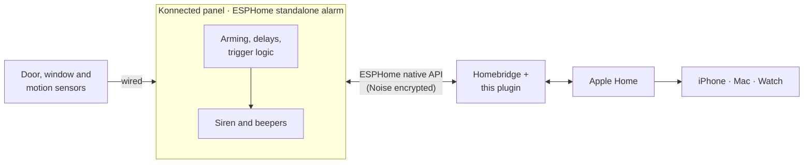

# How it works

## Architecture

The panel runs the alarm. The plugin keeps one long-lived, encrypted connection to it using [esphome-client](https://github.com/hjdhjd/esphome-client), mirrors its state into HomeKit and forwards your arm and disarm requests.

| If this goes down… | What still works |
|---|---|
| Homebridge or its server | **The alarm and siren**, on the panel. You lose Home control and notifications until it's back. |
| Internet | The alarm, siren and Home control on your LAN. No remote notifications. |
| Panel Wi-Fi | The alarm and siren, on the panel. Home shows the tile as faulted. |

## How states map

| Panel (ESPHome) | Apple Home |
|---|---|
| Disarmed | Off |
| Armed home · custom bypass | Home |
| Armed away · vacation | Away |
| Armed night | Night |
| Arming (exit delay) | "Arming…" towards the mode you chose |
| Pending (entry delay) | Stays armed until it triggers, and never shows as Off |
| Triggered | **Triggered**, with Apple's alarm notification |

Modes the panel doesn't support aren't offered in Home, and are refused if requested by other means.

## Requests from Home

1. You choose a mode in Home.
2. If the panel is offline, Home shows *No Response* immediately.
3. Otherwise the plugin sends the command and waits for the panel to confirm: armed, arming (exit delay) or entry delay for an arm request, and disarmed for a disarm.
4. If no confirmation arrives within `commandTimeout` (wrong code, or a mode not allowed right now), Home reverts to the panel's actual state and the log explains why.

Apple Home asks for confirmation before an automation changes a security system. This plugin deliberately offers no switch accessory to get around that.

## Faults

The tile shows a fault:
- until the panel has reported its state after Homebridge starts,
- while the panel is disconnected,
- after a reconnect, until fresh state arrives.

A zone sensor shows a fault while the panel is disconnected or hasn't reported that zone yet.

## Security model

- **Encryption:** the ESPHome native API uses Noise encryption with the panel's API key.
- **Plaintext refused:** with a key configured, the plugin refuses a panel that answers unencrypted.
- **Malformed keys refused:** the underlying library would silently fall back to plaintext on a bad key, so the plugin rejects the panel instead.
- **No secrets in logs:** the alarm code and key are redacted from every log line, including debug.
- **Configured panels only:** discovery never connects to a panel you haven't configured.
